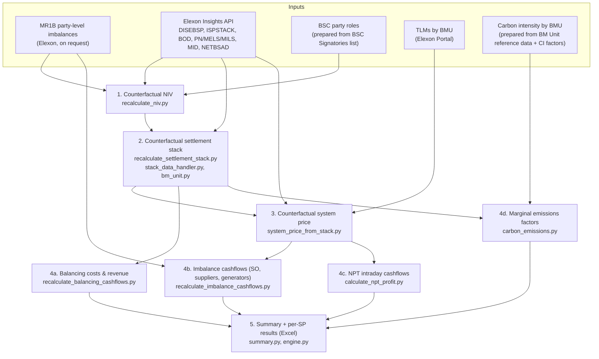

# Replication Guide

This document describes how to reproduce the results in

> Cary, J. and Morstyn, T. *Speculative Imbalance Positions by Non-Physical Traders: Impacts on Electricity System Balancing in Great Britain.* Submitted to *Energy Economics*, 2026.

It covers: (1) which datasets are used and how each can be obtained, (2) which input files must be prepared by hand, (3) how to run the pipeline, (4) what the pipeline outputs, and (5) how those outputs map to the tables and figures in the paper.

---

## 1. Workflow at a glance

The core analysis is a **counterfactual simulation**: for every half-hourly settlement period (SP), the imbalance volumes of non-physical traders (NPTs) are removed from the Net Imbalance Volume (NIV); the Balancing Mechanism (BM) settlement stack is then re-dispatched to meet the counterfactual NIV; the imbalance price is recomputed from the new stack following the Balancing and Settlement Code Section T; and imbalance cashflows, balancing costs and marginal emissions are recalculated under both the factual and counterfactual cases.



Everything above is orchestrated by `gb_analysis/engine.py::run`, which is called from `program.py`.

---

## 2. Data availability

### 2.1 Summary

| Dataset                                                              | Used for                                                                                                                       | Source / endpoint                                                                                                                                                                                            | Access                                                                                                         | Redistributable here?                            | Included in repo?            |
| -------------------------------------------------------------------- | ------------------------------------------------------------------------------------------------------------------------------ | ------------------------------------------------------------------------------------------------------------------------------------------------------------------------------------------------------------ | -------------------------------------------------------------------------------------------------------------- | ------------------------------------------------ | ---------------------------- |
| **Net Imbalance Volume (NIV)** and **System Price (SP)** | Factual NIV; factual SP                                                                                                        | Elexon Insights API — DISEBSP (`/balancing/settlement/system-prices/{date}`)                                                                                                                              | Open, no API key                                                                                               | Yes, with attribution (Elexon BMRS data licence) | No — downloaded at run time |
| **BM settlement stack**                                        | Factual accepted bids/offers, flags, prices; starting point of counterfactual stack                                            | Elexon Insights API — ISPSTACK (`/balancing/settlement/stack/all/{bid\|offer}/{date}/{period}`)                                                                                                            | Open, no API key                                                                                               | Yes, with attribution                            | No — downloaded at run time |
| **Bid–offer data**                                            | Unaccepted bid/offer pairs available for counterfactual dispatch                                                               | Elexon Insights API — BOD (`/balancing/bid-offer/all`)                                                                                                                                                    | Open, no API key                                                                                               | Yes, with attribution                            | No — downloaded at run time |
| **BM physical data**                                           | Headroom per BMU (PN, MELS, MILS) when accepting additional actions                                                            | Elexon Insights API — PN, MELS, MILS (`/balancing/physical/all`)                                                                                                                                          | Open, no API key                                                                                               | Yes, with attribution                            | No — downloaded at run time |
| **Market Index Price**                                         | Price for first-stage-flagged actions when no replacement price is available; fallback SP; intraday valuation of NPT positions | Elexon Insights API — MID (`/balancing/pricing/market-index`), N2EX and APX providers, volume-weighted                                                                                                    | Open, no API key                                                                                               | Yes, with attribution                            | No — downloaded at run time |
| **Price adjustments (BPA/SPA)**                                | Buy/sell price adjustment added to recalculated SP                                                                             | Elexon Insights API — NETBSAD (`/balancing/nonbm/netbsad`)                                                                                                                                                | Open, no API key                                                                                               | Yes, with attribution                            | No — downloaded at run time |
| **Party-level imbalances**                                     | NPT imbalance volumes; factual imbalance charges by party                                                                      | Elexon MR1B reports                                                                                                                                                                                          | **On request** from Elexon Support ([https://support.elexon.co.uk/csm](https://support.elexon.co.uk/csm)) | **No**                                     | **No**                 |
| **Transmission Loss Multipliers**                              | TLM adjustment in SP calculation                                                                                               | Elexon Portal (Winter 2022–23 values)                                                                                                                                                                       | Free registration                                                                                              | Yes, with attribution                            | No                           |
| **BSC party roles**                                            | Classifying parties as NPT / supplier / generator                                                                              | BSC Signatories list ([https://www.elexon.co.uk/bsc/about/elexon-key-contacts/bsc-signatories-qualified-persons/](https://www.elexon.co.uk/bsc/about/elexon-key-contacts/bsc-signatories-qualified-persons/)) | Public web page, transcribed manually                                                                          | Yes (derived from public information)            | Yes                          |
| **BM Unit reference data**                                     | Fuel type per BMU (for carbon intensities, wind/CCGT analyses)                                                                 | Elexon Insights API —`/reference/bmunits/all` (saved as `BM_Units.json`)                                                                                                                                | Open, no API key                                                                                               | Yes, with attribution                            | No                           |
| **Carbon intensity factors**                                   | Emissions factor per fuel type                                                                                                 | National Grid ESO Carbon Intensity API ([https://api.carbonintensity.org.uk/intensity/factors](https://api.carbonintensity.org.uk/intensity/factors))                                                         | Open                                                                                                           | Yes (CC BY 4.0)                                  | No                           |
| **Intraday Prices**                                            | Realised trades data on the GB continuous intraday market for half-hourly delivery contracts                                   | EPEX Spot                                                                                                                                                                                                    | Available for purchase                                                                                         | No                                               | No                           |

All Elexon Insights API data are accessed through the [`elexonpy`](https://pypi.org/project/elexonpy/) client and require no key. API data are fetched live each run, so published values that Elexon later revises (e.g. after reconciliation settlement runs) may cause small differences from the paper. Data downloaded on 28/9/2026.

### 2.2 Processed and intermediate data

The BSC roles, TLM and BM Unit files are in `Supporting Data/`. The carbon intensity mapping is not included and must be built as described in §3.4 (default location: `Supporting Data/BMU Carbon Intensity.xlsx`). MR1B-derived results are not included.

| File                                                        | Content                                   | Contains MR1B-derived data?                                               |
| ----------------------------------------------------------- | ----------------------------------------- | ------------------------------------------------------------------------- |
| BSC roles mapping (`BSC_ID`, `TN`, `TS`, `TG`)      | Role flags per BSC party                  | No                                                                        |
| TLM mapping (`BM Unit ID`, `TLM`)                       | TLM per BMU                               | No                                                                        |
| Carbon intensity mapping (`BMU_ID`, `Carbon Intensity`) | kgCO2/MWh per BMU                         | No                                                                        |
| `BM_Units.json` | BM Unit reference data (fuel type per BMU), downloaded from the Elexon Insights API | No |
| Per-month and aggregate results workbooks (Section 5)       | Per-SP factual and counterfactual results | **Yes** — aggregate NPT imbalance per SP, and party-type cashflows |

---

## 3. Preparing the input files

`program.py` expects three hand-prepared Excel files plus a folder of MR1B reports. Column names must match exactly.

### 3.1 MR1B reports (on request from Elexon)

- One file per month, named `MR1B_YYYY_MM.xlsx` (e.g. `MR1B_2021_10.xlsx`). Files not matching this pattern are skipped with a warning.
- Required columns:

| Column                                               | Meaning                                                                         |
| ---------------------------------------------------- | ------------------------------------------------------------------------------- |
| `Party ID`                                         | BSC party ID (must match`BSC_ID` in the roles file)                           |
| `Settlement Date`                                  | Settlement date                                                                 |
| `Settlement Period`                                | Settlement period (1–46/48/50, one for each half hour in the day)              |
| `Energy Imbalance Vol`                             | Party energy imbalance volume (MWh; positive = long)                            |
| `Imbalance Charge`                                 | Party imbalance charge (£; positive = paid by the party)                       |
| `Credited Energy Vol` *or* `CreditedEnergyVol` | Credited (metered) energy volume; used only in the zero-metered-volume scenario |

- Leading/trailing whitespace in text cells is stripped on load.
- Set the folder containing these files as `mr1b_directory` in `program.py` (see Section 4.2). The auxiliary functions in Section 6 take the same folder as an argument.

### 3.2 BSC party roles (`bsc_roles` in `program.py`)

Excel file with one row per BSC party:

| Column     | Type | Meaning                                     |
| ---------- | ---- | ------------------------------------------- |
| `BSC_ID` | str  | BSC party ID                                |
| `TN`     | bool | Party holds the*non-physical trader* role |
| `TS`     | bool | Party holds the*supplier* role            |
| `TG`     | bool | Party holds the *generator* role         |

Constructed manually from the Elexon BSC Signatories list from July 2025.

Parties `CBBLESTN` and `OLDKENT` are excluded from the NPT imbalance aggregation in `recalculate_niv.py` because of errors in the MR1B data for these IDs. Later settlement runs may have removed these errors.

### 3.3 Transmission Loss Multipliers (`tlms` in `program.py`)

Excel file with columns `BM Unit ID` and `TLM`. Winter 2022–23 values from the Elexon Portal are applied to all periods. BMUs that are not listed get a TLM of 1.

### 3.4 Carbon intensity by BMU (`bmu_id_to_ci_mapping` in `program.py`)

Excel file with columns `BMU_ID` and `Carbon Intensity` (kgCO2/MWh). To build it:

1. Download BM Unit reference data from `/reference/bmunits/all` and save it as JSON (`BM_Units.json`).
2. Build an Excel file with columns `FUEL` and `kgCO2/MWh`, mapping each Elexon `fuelType` value (e.g. `CCGT`, `COAL`, `WIND`) to the corresponding factor from the Carbon Intensity API. This mapping is done by hand.
3. Run `gb_analysis/carbon_emissions.py::create_emissions_dataset(bm_units_json, fuel_ci_xlsx, output_filename, output_directory)`.
4. **Rename the output columns** from `elexonBmUnit`, `carbon_intensity` to `BMU_ID`, `Carbon Intensity`, which are the names `engine.py` reads.

BMUs whose fuel type has no factor are dropped, so their MEF is reported as empty.

---

## 4. Running the pipeline

### 4.1 Environment

The results were produced with Python 3.12 and the package versions pinned in `requirements.txt`:

```bash
conda create -n niv-chasing python=3.12
conda activate niv-chasing
pip install -r requirements.txt
```

### 4.2 Configuration

Edit the variables at the top of `program.py`:


| Variable                     | Meaning                                                                                                                                                                                               | Value used in the paper          |
| ---------------------------- | ----------------------------------------------------------------------------------------------------------------------------------------------------------------------------------------------------- | -------------------------------- |
| `years`, `months`        | Months to process (every month is run for every year listed)                                                                                                                                          | Jan 2021 - Dec 2024              |
| `output_directory`         | Where result workbooks are written                                                                                                                                                                    | —                               |
| `mr1b_directory`           | Folder with the monthly MR1B reports from §3.1 | Not redistributable; obtain from Elexon |
| `bsc_roles`                | Path to file from §3.2                                                                                                                                                                               | —                               |
| `tlms`                     | Path to file from §3.3                                                                                                                                                                               | —                               |
| `bmu_id_to_ci_mapping`     | Path to file from §3.4                                                                                                                                                                               | —                               |
| `strict_npt`               | `True`: NPT = holds TN role and neither TS nor TG. `False`: any party holding TN                                                                                                                  | True                             |
| `strict_supplier`          | `True`: supplier = TS only. `False`: any party holding TS                                                                                                                                         | True                             |
| `strict_generator`         | `True`: generator = TG only. `False`: any party holding TG                                                                                                                                        | True                             |
| `zero_metered_volume_only` | `True`: remove only NPT accounts with zero credited energy volume from counterfactual NIV calculation (**ZMV** scenario). `False`: remove all NPT imbalance volume (**AMV** scenario) | Both True (ZMV) and False (AMV) |

### 4.3 Run

```bash
python program.py
```

For each month, the code writes a workbook `{year}-{month}.xlsx` to `output_directory`. Once all months are done, it writes an aggregate workbook `{first_year}-{first_month}_to_{last_year}-{last_month}_results.xlsx`. If a file with the same name already exists, a timestamp is added to the new file's name rather than overwriting the old one.

**Runtime and API load.** Each settlement period needs roughly six API requests (two ISPSTACK, one BOD, three physical), plus day-level requests for DISEBSP, MID and NETBSAD. That is about 9,000 requests per month. Requests are made concurrently. Failed BOD and physical requests are retried up to three times with exponential backoff.

**Missing data.** An SP is marked missing if any required source returns no data for it (DISEBSP, MR1B, MID, ISPSTACK, BOD, or PN/MELS/MILS). Missing SPs are listed in the `Missing Data` sheet and dropped from the per-month result sheets.

---

## 5. Pipeline detail and outputs

### 5.1 Steps

| Step | Module / function                                                             | What it does                                                                                                                                                                                                                                                                                                                                                                                                                                                                                                                                                                                                        |
| ---- | ----------------------------------------------------------------------------- | ------------------------------------------------------------------------------------------------------------------------------------------------------------------------------------------------------------------------------------------------------------------------------------------------------------------------------------------------------------------------------------------------------------------------------------------------------------------------------------------------------------------------------------------------------------------------------------------------------------------- |
| 1    | `recalculate_niv.recalculate_niv` / `recalculate_niv_zero_metered_volume` | Sums MR1B`Energy Imbalance Vol` over NPT parties for each SP, then sets `counterfactual_niv = net_imbalance_volume + npt_total_imbalance` (Elexon sign convention: positive NIV = system short).                                                                                                                                                                                                                                                                                                                                                                                                                |
| 2    | `recalculate_settlement_stack.recalculate_stacks`                           | Rebuilds each SP's settlement stack for the counterfactual NIV. There are four cases, depending on the signs of the factual and counterfactual NIV. When more balancing is needed in the same direction, further bid/offer pairs from BOD are accepted in merit order, starting from the marginal unflagged action and limited by each BMU's headroom (PN, MELS, MILS;`bm_unit.py`). When less balancing is needed, accepted energy actions are removed from the margin inward. When the sign of the NIV flips, actions in the original direction are removed and actions in the opposite direction are accepted. |
| 3    | `system_price_from_stack.get_new_system_prices_by_date_and_period`          | Recomputes the imbalance price from the counterfactual stack following BSC Section T, Annex T-1: de minimis tagging (0.1 MWh), arbitrage tagging, SO/CADL flag classification, NIV tagging, replacement price (RPAR = 1 MWh), PAR tagging (1 MWh), TLM adjustment, then adds BPA/SPA from NETBSAD. If the stack is empty, the MID price is used.                                                                                                                                                                                                                                                                    |
| 4a   | `recalculate_balancing_cashflows`                                           | Balancing cost = Σ price × volume over the stack, for the factual and counterfactual stacks, also broken down by BMU group (first character of the BMU ID).                                                                                                                                                                                                                                                                                                                                                                                                                                                       |
| 4b   | `recalculate_imbalance_cashflows`                                           | Factual cashflows come from MR1B`Imbalance Charge`. Counterfactual cashflows set NPT volumes to zero and revalue the remaining `Energy Imbalance Vol` at the recalculated SP. Calculated for the SO, suppliers and generators.                                                                                                                                                                                                                                                                                                                                                                                  |
| 4c   | `calculate_npt_profit`                                                      | The NPT intraday position is taken as the negative of its imbalance volume, valued at MID. The negated value is the counterparty (`Intraday Cashflows`) cashflow. NPT profit is not estimated in the paper.                                                                                                                                                                                                                                                                                                                                                                                                                                     |
| 4d   | `carbon_emissions.calculate_marginal_emissions`                             | The marginal unflagged action in the factual and counterfactual stacks is mapped to a carbon intensity via its BMU.                                                                                                                                                                                                                                                                                                                                                                                                                                                                                                 |
| 5    | `summary.create_summary_table`                                              | Factual vs counterfactual summary statistics.                                                                                                                                                                                                                                                                                                                                                                                                                                                                                                                                                                       |

### 5.2 Result workbook sheets

| Sheet                                                           | Key columns                                                                                          | Units            |
| --------------------------------------------------------------- | ---------------------------------------------------------------------------------------------------- | ---------------- |
| `Summary`                                                     | `Statistic Name`, `Factual`, `Counterfactual`, `Difference`                                  | as per statistic |
| `Missing Data`                                                | `settlement_date`, `settlement_period`                                                           | —               |
| `System Prices`                                               | `system_sell_price` (factual), `recalculated_system_price`                                       | £/MWh           |
| `System Imbalances`                                           | `net_imbalance_volume`, `npt_total_imbalance`, `counterfactual_niv`, `system_sell_price`     | MWh, £/MWh      |
| `Balancing Costs`                                             | `balancing_costs`, `recalculated_balancing_costs`                                                | £               |
| `Original Balancing Revenue` / `New Balancing Revenue`      | one column per BMU group                                                                             | £               |
| `SO Cashflows`                                                | `energy_imbalance_cashflow`, `recalculated_energy_imbalance_cashflow` (positive = SO revenue)    | £               |
| `Supplier Cashflows` / `Generator Cashflows`                | `energy_imbalance_cashflow`, `recalculated_energy_imbalance_cashflow` (positive = party profit)  | £               |
| `Intraday Cashflows`                                          | `id_cashflow` (counterparties to NPT intraday trades)                                              | £               |
| `Marginal Emissions Factors` (monthly) / `MEFs` (aggregate) | `factual_mef`, `factual_marginal_unit`, `counterfactual_mef`, `counterfactual_marginal_unit` | kgCO2/MWh        |

---

## 6. Auxiliary analyses

These functions are not called by `program.py`. Call them from a short script, as below.

| Function                                                                                                                                    | Inputs                                                                  | Output                                                                                |
| ------------------------------------------------------------------------------------------------------------------------------------------- | ----------------------------------------------------------------------- | ------------------------------------------------------------------------------------- |
| `gb_analysis.bm_analysis.calculate_balancing_costs_breakdown(out_dir, name, years)`                                                       | ISPSTACK                                                                | Energy balancing cost (unflagged) vs system balancing cost (SO-flagged), per SP       |
| `gb_analysis.engine.determine_supplier_net_position(years, months, mr1b_dir, bsc_roles, out_dir)`                                                   | MR1B                                                                    | Aggregate supplier imbalance per SP, under both strict and loose supplier definitions |
| `gb_analysis.recalculate_imbalance_cashflows.recalculate_imbalance_cashflows_from_excel(bsc_roles, price_xlsx, sheet, mr1b_dir, out_dir)` | MR1B, a workbook of recalculated prices with columns`AMV` and `ZMV` | SO, supplier, generator and mixed-role cashflows under both AMV and ZMV scenarios     |

\* `BM_Units.json` is read from `Supporting Data/BM_Units.json` in this repository.

Example:

```python
import asyncio
from gb_analysis.bm_analysis import calculate_balancing_costs_breakdown

asyncio.run(calculate_balancing_costs_breakdown("outputs/", "balancing_cost_breakdown", [2022, 2023]))
```

---

## 7. Mapping to the paper

| Paper element | Quantity                                                   | Produced by    | Where to find it                                 |
| ------------- | ---------------------------------------------------------- | -------------- | ------------------------------------------------ |
| Table 3       | Factual vs counterfactual average SP and SP volatility     | `program.py` | Aggregate workbook →`Summary`                 |
| Table 3       | NIV statistics (mean, mean absolute, s.d., total absolute) | `program.py` | `Summary`; per SP in `System Imbalances`     |
| Table 3       | Total balancing costs                                      | `program.py` | `Summary`; per SP in `Balancing Costs`       |
| Table 3       | Imbalance cashflows by SO, suppliers, generators           | `program.py` | `Summary`; `SO/Supplier/Generator Cashflows` |
| Discussion    | Average marginal emissions factor                          | `program.py` | `Summary`; `MEFs`                            |
| Figure 5      | Distribution of factual vs counterfactual NIV              | `program.py` | `System Prices`, `System Imbalances`         |

Figures were produced from these workbooks using matplotlib.

---

## 8. Applying the method outside GB

The method is specific to GB, but its structure carries over to other markets. It needs:

1. **Party-level imbalance volumes** with a way to identify speculative (non-physical) parties. In GB this is MR1B plus BSC roles.
2. **The ordered set of balancing actions taken** for each imbalance settlement period, with flags that separate energy balancing from system (e.g. constraint) balancing. In GB this is ISPSTACK.
3. **Unused balancing bids/offers and unit headroom**, to re-dispatch to a different imbalance. In GB this is BOD plus PN/MELS/MILS.
4. **The imbalance pricing rules.** `system_price_from_stack.py` implements BSC Section T and would need to be replaced for another market's rules.

---

## 9. Citation and contact

See [README.md](README.md#citation). Questions: Joseph Cary, joseph.cary@wolfson.ox.ac.uk.
